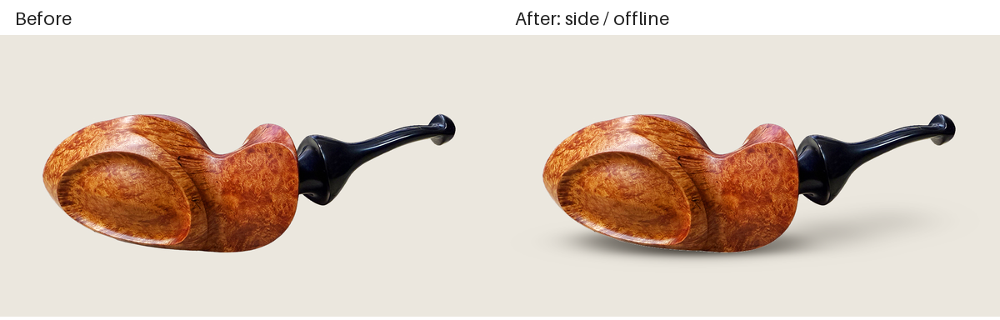
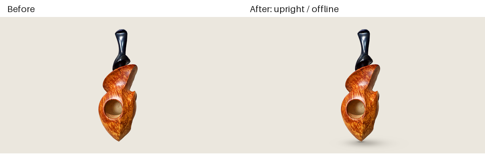
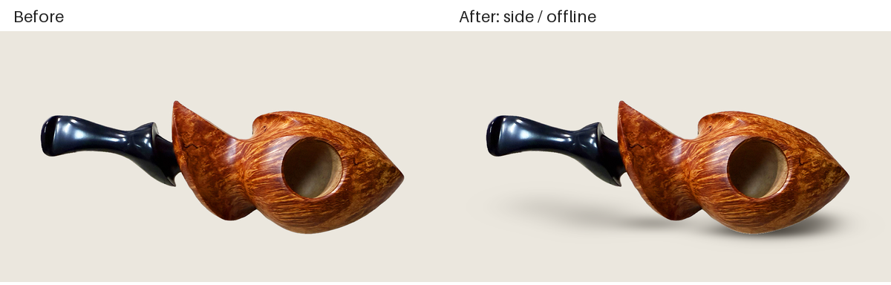

# Tabletop Shadow

**Offline tabletop shadows. Initial tested preset: pipe product photos.**

[中文说明](README.zh-CN.md) · [Agent skill](SKILL.md) · [Detailed usage](references/usage.md) · [MIT license](LICENSE)

Turn an already isolated pipe on a plain background into a grounded product photo. Every photo is treated as resting on a tabletop through the lowest visible point of the complete object, regardless of camera angle or physical plausibility. The renderer preserves protected product pixels and adds a separate contact/cast shadow layer.



The examples above and below are actual local-script output, not image-generation results.

## Features

- No image-generation API, model weights, cloud service or GPU during processing.
- Python 3.10+, Pillow and NumPy. Validated on Windows; the portable Python implementation has not been independently validated on Linux/macOS.
- Single-image and recursive batch processing, with per-image configuration.
- Lossless PNG composite, transparent shadow layer and a verification report.
- Product protection checks, source-file fingerprints and no source overwrites.
- A ready-to-use Hermes Agent skill in [SKILL.md](SKILL.md).

## Quick start

In a Python 3.10+ environment:

```sh
git clone https://github.com/Wynn-Wan/tabletop-shadow.git
cd tabletop-shadow
python -m pip install -r requirements.txt
python scripts/add_shadow.py examples/input/side.png --view side --output output/side --debug
```

Dependency setup may need the internet once. Rendering itself makes no network calls. For an offline machine, prepare matching Pillow/NumPy wheels and use `python -m pip install --no-index --find-links /path/to/wheels -r requirements.txt`.

### Standing upright

```sh
python scripts/add_shadow.py examples/input/upright.png --view upright --output output/upright --debug
```



`upright` concentrates the shadow around the object's lowest support and nearby tabletop. This shape suits vertical compositions; the upper body and stem do not receive an outline shadow. The tabletop baseline always comes from the complete foreground's lowest point.

### Bowl-facing side view

```sh
python scripts/add_shadow.py examples/input/bowl-facing.png --view side --output output/bowl-facing --debug
```



This photo also rests on its lowest visible point, with a `side` footprint, even though the bowl opening faces the camera. The example formerly named `top-view.png` has been renamed to `bowl-facing.png` to avoid implying a different placement. Since v1.3.0, legacy `--view flat` configurations use grounded `auto` placement and report a warning; they no longer produce an all-around silhouette shadow.

### Batch

```sh
python scripts/add_shadow.py examples/input --output output/batch --config examples/config.json --debug
```

Add `--recursive` for nested input folders. The output tree is excluded from recursive input discovery. Generated outputs are not silently replaced; choose a new output directory, or explicitly use `--overwrite` to replace previous generated files.

The full output plan is checked before writing. Inputs such as `photo.jpg` and `photo.png` in the same folder would collide, so the batch is rejected until they are renamed or separated. Supplied input images, masks and configuration files cannot be replaced through an output alias.

New output PNGs carry a path-free generator marker. Directory batches skip those images, or older outputs identified by a matching verification report. A legacy image stripped of both marker and report cannot be reliably identified as generated; select original-input folders rather than mixing them with such old results. An explicitly selected image is still processed as requested. Unknown configuration keys and invalid RGB values are rejected.

## Use with Hermes Agent

Clone the repository and install the Python dependencies in the interpreter Hermes will use, then run:

```sh
python scripts/install_skill.py --dry-run
python scripts/install_skill.py
```

The installer copies the skill into `$HERMES_HOME/skills/tabletop-shadow`, or `~/.hermes/skills/tabletop-shadow` when `HERMES_HOME` is unset. Existing installations are not overwritten. Use `--hermes-home /path/to/profile` for another profile or `--destination /path/to/tabletop-shadow` for an explicit destination.

In a fresh Hermes conversation, say:

> Use tabletop-shadow to add offline tabletop shadows to this folder. The vertical pipe stands on its bottom; use upright mode for it.

Manual installation is also possible: copy the skill directory and its `scripts`, `assets` and `references` into your Hermes skills folder. Hermes' skill format and path-variable handling are documented in the [official skill authoring guide](https://hermes-agent.nousresearch.com/docs/developer-guide/creating-skills/).

## Output and controls

| Output | Meaning |
|---|---|
| `name_shadow.png` | Lossless composite; dimensions and protected product pixels are retained. |
| `name_shadow-only.png` | Transparent shadow overlay; protected regions have zero alpha for opaque inputs. |
| `name_shadow-report.json` | Mode, parameters, source fingerprint, warnings and preservation checks. |
| `name_cleaned-base.png` | Saved only when faint old support shadows are cleaned; use this base with the separate shadow overlay. |
| `name_protected-mask.png` | Product protection mask, enabled with `--debug`. |

Useful controls: `--strength 0.8`, `--stem-strength 1.2`, `--softness 1.1` and `--ground-y 615`. See [usage and configuration](references/usage.md) for parameter meanings and precedence.

## How it works and limits

The tabletop baseline is the maximum y coordinate of the complete foreground, including the mouthpiece if it is lower than the bowl. The default side renderer adapts a small empirical Gaussian density field to body dimensions, that baseline and mouthpiece geometry, plus a local contact shadow. Upright mode computes a footprint around the lowest support. These are deterministic 2D approximations following the same placement convention, not physically reconstructed 3D shadows.

The numeric side-view parameters were calibrated during development against an image-generated visual reference. Only numeric parameters ship in the renderer; no generative model or generated reference image is needed at runtime.

The protection region is estimated from source alpha, a supplied mask, or color difference from a plain border background. Enclosed pale highlights are protected. The bulky body is identified by silhouette thickness; material colors are only trusted after a coverage/support check, so a black bowl with a brown shank is not inverted. Faint neutral residue near the support can be cleaned before adding the new shadow; use `--keep-existing-shadows` to disable it. `foreground_changed_pixels: 0` verifies the protected region; it cannot prove the mask is semantically correct. Inspect the debug mask for difficult photos. Busy backgrounds, strong old shadows, multiple objects and unusual materials/poses may need a supplied mask or manual adaptation.

The default `auto` mode uses bounding-box proportions to choose a footprint shape: tall foregrounds use `upright`, others use `side`. Both use the same lowest-point tabletop rule. Camera angle does not select a separate flat-lay model. This tool does not isolate the pipe, replace backgrounds, rotate it, relight it or guarantee a correct shadow for every possible pipe shape.

Regression coverage currently includes 18 photographs of three different pipes. Other small-object categories are experimental until tested; the broader project name is not a claim of universal support.

## Development

```sh
python -X utf8 scripts/test_add_shadow.py
python -X utf8 scripts/test_install_skill.py
python scripts/make_examples.py
python scripts/build_release.py
```

Tests cover product/highlight preservation, lowest-point support including a lower mouthpiece, upright base placement, absence of an upper-stem halo, legacy flat-config migration, transparent input, mouthpiece shadows, batch behavior, no source overwrite and rendering with sockets blocked. The bundled photo examples can be regenerated locally. Release archives and checksums are written to `dist/`.

## License and images

Code, documentation and numeric calibration parameters are MIT-licensed. The example photographs and photo-derived previews are included with permission for project demonstrations and are outside the MIT grant; see [examples/NOTICE.md](examples/NOTICE.md). No third-party shop photographs are bundled. Pillow and NumPy retain their respective licenses.
