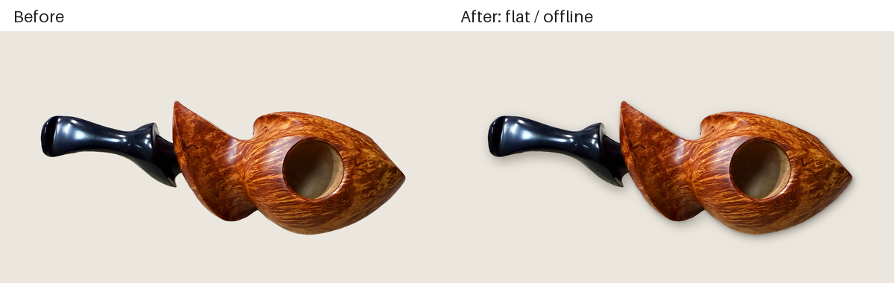

# Tabletop Shadow · 桌面自然阴影

**离线桌面阴影。当前经过实图验证的预设适用于烟斗商品照片。**

[English](README.md) · [Skill 指令](SKILL.md) · [详细用法](references/usage.md) · [MIT 许可证](LICENSE)

给已换好纯色背景的单把烟斗补上接触阴影和柔散投影，让它看起来放在桌面上。脚本保留主体保护区像素，另存独立阴影层，支持侧面、底部着桌竖立和俯拍平躺。


以上和下方预览都是仓库中本地脚本的实际输出。

## 功能

- 处理时不使用生图 API、模型权重、云服务或 GPU。
- 依赖 Python 3.10+、Pillow 和 NumPy。已在 Windows 验证；Linux/macOS 尚未独立实测。
- 支持单张、递归批量处理和逐图参数配置。
- 输出无损 PNG 合成图、透明阴影层和校验报告。
- 检查主体保护区、记录源文件指纹，不覆盖输入原图。
- 提供可直接用于 Hermes Agent 的 [SKILL.md](SKILL.md)。

## 快速开始

在 Python 3.10+ 环境中运行：

```sh
git clone https://github.com/Wynn-Wan/tabletop-shadow.git
cd tabletop-shadow
python -m pip install -r requirements.txt
python scripts/add_shadow.py examples/input/side.png --view side --output output/side --debug
```

首次准备依赖可能需要联网，实际加阴影时没有网络调用。离线电脑可提前准备匹配系统和 Python 版本的 Pillow/NumPy wheel，再执行 `python -m pip install --no-index --find-links /path/to/wheels -r requirements.txt`。

### 底部着桌竖立

```sh
python scripts/add_shadow.py examples/input/upright.png --view upright --output output/upright --debug
```


`upright` 将阴影集中在木质底部支点和邻近桌面，不会沿整根烟嘴加光晕。照片朝向不等于实际摆放：从上方拍摄、平躺在桌面的烟斗应使用 `flat`，即使它在图片里上下朝向。

### 俯拍平躺

```sh
python scripts/add_shadow.py examples/input/top-view.png --view flat --output output/flat --debug
```



### 批量处理

```sh
python scripts/add_shadow.py examples/input --output output/batch --config examples/config.json --debug
```

可加 `--recursive` 处理子目录，输出目录会从递归输入中排除。已有成品不会被自动替换；调整时换一个输出目录，或明确使用 `--overwrite` 替换之前生成的文件。

写入前会检查完整输出计划。同目录的 `photo.jpg` 和 `photo.png` 会撞到同一输出，必须先改名或分开处理。给定的输入图片、蒙版和配置文件不能通过输出别名被替换。

新版 PNG 带有不含路径的生成标记。目录批量会跳过这些图片，也会通过同目录校验报告识别旧版成品。既无标记又无报告的旧图无法可靠识别，应选择原图目录，避免混入这些旧成品。直接指定单张图片时仍按请求处理。未知配置键、非法 RGB 等会明确报错。

## 给 Hermes Agent 安装

克隆仓库，在 Hermes 将使用的 Python 解释器中安装依赖，然后运行：

```sh
python scripts/install_skill.py --dry-run
python scripts/install_skill.py
```

默认复制到 `$HERMES_HOME/skills/tabletop-shadow`；未设置 `HERMES_HOME` 时，使用用户目录下的 `.hermes/skills/tabletop-shadow`。安装脚本不覆盖已有版本。自定义配置目录可用 `--hermes-home /path/to/profile`，明确指定安装位置可用 `--destination /path/to/tabletop-shadow`。

在 Hermes 新会话中说：

> 用 tabletop-shadow 给这个目录里的烟斗加离线桌面阴影。其中竖着的烟斗是底部着桌竖立，用 upright 模式。

也可手动将 skill 目录及其 `scripts`、`assets`、`references` 复制到 Hermes 的 skills 目录。Hermes 的 skill 格式和路径变量说明见[官方编写指南](https://hermes-agent.nousresearch.com/docs/developer-guide/creating-skills/)。

## 输出和调整

| 输出 | 含义 |
|---|---|
| `name_shadow.png` | 无损合成图，保留原尺寸和主体保护区像素。 |
| `name_shadow-only.png` | 透明阴影层；不透明输入的主体保护区 alpha 为 0。 |
| `name_shadow-report.json` | 模式、参数、源文件指纹、警告和像素检查。 |
| `name_cleaned-base.png` | 仅在清理浅灰旧影时保存；独立阴影层叠在它上面可还原合成结果。 |
| `name_protected-mask.png` | 主体保护蒙版，使用 `--debug` 输出。 |

常用调整包括 `--strength 0.8`、`--stem-strength 1.2`、`--softness 1.1` 和 `--ground-y 615`。参数含义与优先级见[详细用法和配置](references/usage.md)。

## 原理和适用范围

默认侧面渲染器使用经验高斯密度场，按斗身尺寸、最低支点和烟嘴形状调整，并增加局部接触阴影。竖立模式单独计算底部落影；俯拍模式使用短偏移的柔散轮廓投影。这些是确定性的二维近似，无法从单张照片重建真实三维阴影。

侧面数值参数在开发时参考了一张生图视觉样本进行校准。渲染器仅包含数值参数，运行时不需要生成模型或那张参考图。

保护区根据源图透明度、用户蒙版或主体与纯色边缘背景的色差估计，封闭区域内的浅色高光也会受到保护。斗身优先按轮廓厚度识别，颜色分区通过覆盖与支撑点检查后才使用，避免黑斗钵和棕色斗柄被认反。默认清理纯色底里靠近支点的浅灰残影，可用 `--keep-existing-shadows` 关闭。`foreground_changed_pixels: 0` 只证明保护区内未改像素，不能证明蒙版语义完全正确；复杂照片需要查看调试蒙版。复杂背景、明显旧投影、多物品和特殊材质或姿态可能需要准确蒙版或单独适配。

默认 `auto` 仅按主体外框宽高比初选模式，已知实际摆放时应显式指定。工具不负责抠图、换背景、旋转或重新打光，也不保证所有烟斗形状都能直接得到正确阴影。

当前实图回归覆盖 3 把烟斗、18 张照片。其他小物件仍属实验范围，项目名称扩大不代表已经支持所有物品。

## 开发和验证

```sh
python -X utf8 scripts/test_add_shadow.py
python -X utf8 scripts/test_install_skill.py
python scripts/make_examples.py
python scripts/build_release.py
```

测试包括主体与高光保真、竖立底部落影、上方无描边、透明图、烟嘴投影、批量、不覆盖原图，以及禁用网络后的处理。仓库内的照片示例可以本地重新生成，分发 ZIP 和校验文件写入 `dist/`。

## 许可证和图片

代码、文档和数值参数采用 MIT 许可证。示例照片及其预览获准用于本项目演示，不包含在 MIT 授权内，详见[图片声明](examples/NOTICE.md)。仓库未包含第三方店铺照片。Pillow 和 NumPy 保留各自的许可证。
