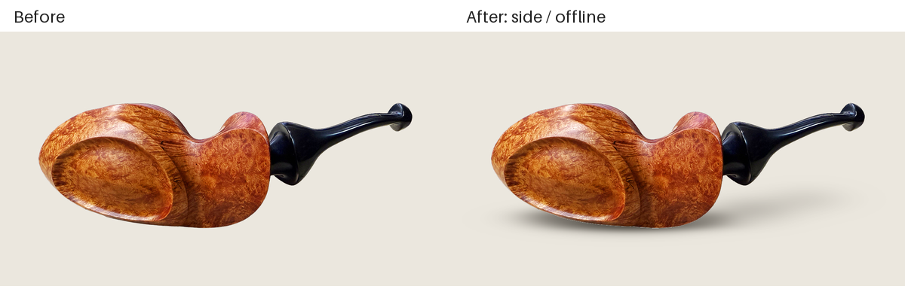
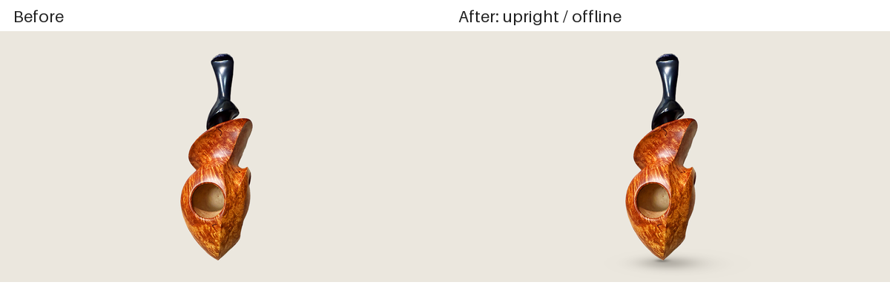

# Tabletop Shadow · 桌面自然阴影

**给已换好纯色背景的单把烟斗照片增加自然阴影，处理全程离线。**

[English](README.md) · [Skill 指令](SKILL.md) · [参数说明](references/usage.md)

用本地 Python 脚本补上接触阴影和柔散投影，保留烟斗的木纹、颜色、光泽和构图。支持横放、底部着桌竖立、俯拍平躺，也可整批处理。



以上和下方预览都由仓库里的本地脚本生成。

## 使用

需要 Python 3.10+、Pillow 和 NumPy。

```sh
git clone https://github.com/Wynn-Wan/tabletop-shadow.git
cd tabletop-shadow
python -m pip install -r requirements.txt
python scripts/add_shadow.py examples/input/side.png --view side --output output/side --debug
```

首次准备依赖可能需要联网；实际加阴影时不调用生图、API、模型或 GPU，不下载任何资源。离线电脑可提前准备匹配系统和 Python 版本的 wheel，使用 `pip --no-index --find-links` 安装。

## 三种摆放模式

| 参数 | 适用情况 |
|---|---|
| `--view side` | 横放或 3/4 侧面，斗身贴桌，烟嘴稍微抬起。 |
| `--view upright` | 烟斗底部着桌竖立，阴影主要在底部。 |
| `--view flat` | 俯拍平躺在桌面，使用短偏移的柔散轮廓投影。 |
| `--view auto` | 初选：细长竖向主体用 upright，其他用 side；可显式覆盖。 |

**照片里上下朝向不等于物体平躺。** 需要竖立效果就明确用 `upright`，不应靠增加 flat 的浓度来补救。



```sh
python scripts/add_shadow.py examples/input/upright.png --view upright --output output/upright --debug
python scripts/add_shadow.py examples/input/top-view.png --view flat --output output/flat --debug
```

## 给 Hermes 安装

在 Hermes 将使用的 Python 环境中安装上述依赖，然后：

```sh
python scripts/install_skill.py --dry-run
python scripts/install_skill.py
```

默认复制到 `$HERMES_HOME/skills/tabletop-shadow`，未设置时使用用户目录的 `.hermes/skills/tabletop-shadow`。安装脚本不覆盖已有版本。自定义位置可用 `--hermes-home` 或 `--destination`。

在 Hermes 新会话中说：

> 用 tabletop-shadow 给这个目录里的烟斗加离线桌面阴影。其中竖着的烟斗是底部着桌竖立，用 upright 模式。

## 批量处理和输出

```sh
python scripts/add_shadow.py examples/input --output output/batch --config examples/config.json --debug
```

可加 `--recursive` 处理子目录；每张可以单独设置视角与参数。原图不会被覆盖，重复调整请换输出目录。

批量会先检查完整输出计划：同目录 `photo.jpg` 与 `photo.png` 会撞到同一输出，必须先改名或分开处理。即使用 `--overwrite`，也不能覆盖给定的输入图片、蒙版或配置文件。

新版 PNG 带有不含路径的生成标记，批量处理会自动跳过它们；旧版可通过同目录校验报告识别。既无标记又无报告的旧成品无法可靠识别，应选原图目录，避免与这些旧成品混放。直接指定单张图片时仍按用户请求处理。参数拼写错误、非法 RGB 等会明确报错。

- `*_shadow.png`：原尺寸、无损合成图。
- `*_shadow-only.png`：独立透明阴影层，不透明输入的主体保护区 alpha 为 0。
- `*_shadow-report.json`：模式、参数、源文件指纹与像素检查。
- `*_cleaned-base.png`：清理了底部旧灰影时额外保存的底图，独立阴影层叠在它上面可还原合成结果。
- `*_protected-mask.png`：主体保护区，使用 `--debug` 输出。

常用参数为 `--strength`（整体浓淡）、`--stem-strength`（烟嘴或竖立时的底部远处投影）、`--softness`（扩散范围）、`--ground-y`（接触基准）。完整说明见 [references/usage.md](references/usage.md)。

## 精度和适用范围

这是依据经验阴影参数与二维形状近似进行的本地合成。它保留主体保护区像素，不重绘木纹；`foreground_changed_pixels: 0` 只证明蒙版覆盖区域未变化，还需要看蒙版有没有漏掉高光或边缘。

适合已换好纯色背景的单把烟斗。斗身优先按轮廓厚度识别，颜色分区通过覆盖与支撑点检查后才使用，避免黑斗钵被误当成烟嘴。默认清理纯色底里靠近支点的浅灰残影，可用 `--keep-existing-shadows` 关闭；复杂背景、明显旧投影、多物品、低对比或反光材质仍可能需要准确蒙版或单独适配。单张图片不能唯一恢复真实三维支撑与光照，特殊姿态要看预览。

当前实图回归覆盖 3 把烟斗、18 张照片；其他小物件仍需独立验证。代码在 Windows 验证过，Linux/macOS 的平台实测尚未完成。

## 测试和打包

```sh
python -X utf8 scripts/test_add_shadow.py
python -X utf8 scripts/test_install_skill.py
python scripts/make_examples.py
python scripts/build_release.py
```

测试包括主体和高光保真、竖立底部落影、上方无描边、透明图、烟嘴投影、批量、不覆盖原图和禁止网络的处理。`dist/` 下生成可分发 ZIP 与校验文件。

代码、文档和数值参数采用 [MIT](LICENSE) 许可证。示例照片获准用于本项目演示，不包含在 MIT 授权内，详见 [图片声明](examples/NOTICE.md)。
